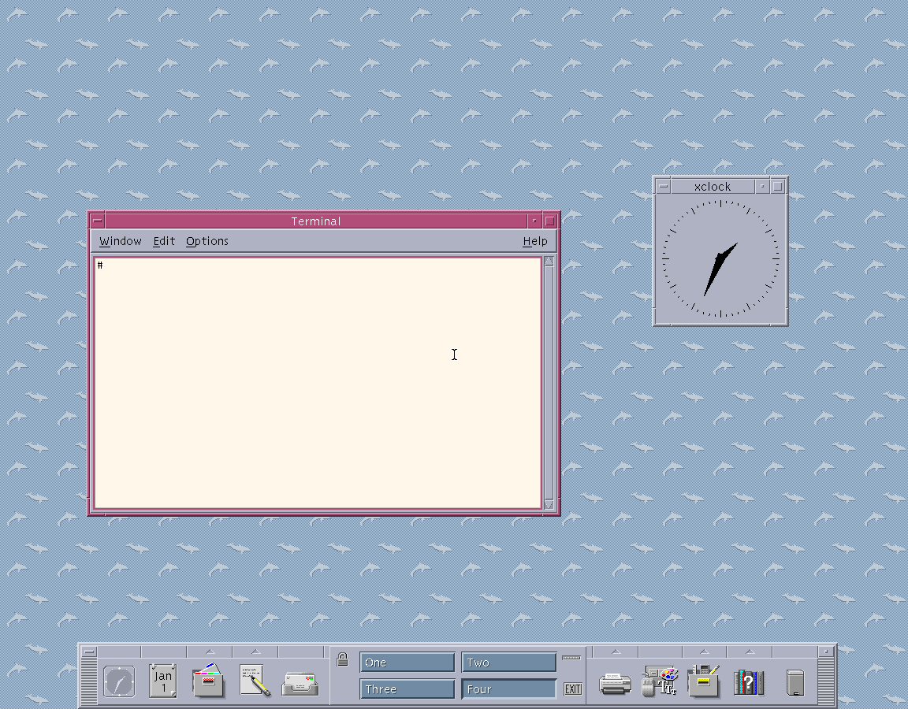
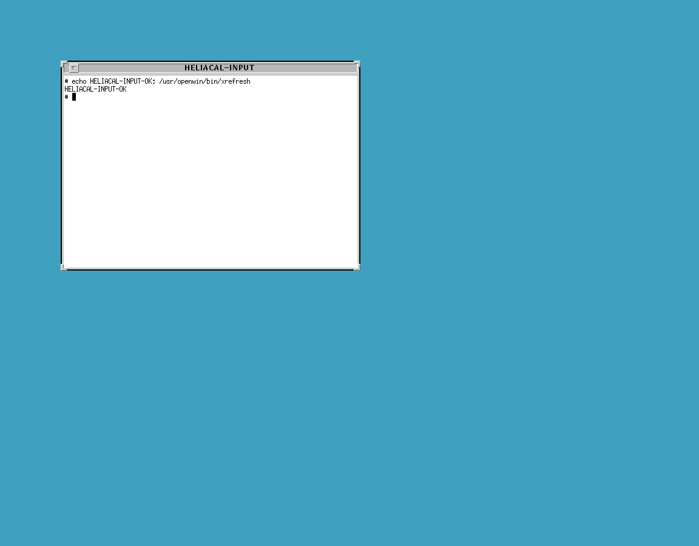

# Heliacal


**Heliacal is a desktop frontend for the [Helios](https://github.com/salvogendut/helios)
emulator. Helios performs all CPU, device and machine emulation.**

Heliacal provides a native Rust/SDL3 interface for Sun SPARC workstations,
following [Prismatic](https://github.com/salvogendut/prismatic) and the Happy
Years emulators ([1984](https://github.com/salvogendut/1984),
[1985](https://github.com/salvogendut/1985),
[1986](https://github.com/salvogendut/1986), and
[1989](https://github.com/salvogendut/1989)).

Supported machines are **Sun SPARCstation 5**, **Sun SPARCstation 20**, and
**Axil 320**, with **128 MiB RAM by default**. SS-5 and Axil use TurboGX/CGsix;
SS-20 offers native SX/CG14 or TurboGX. Memory choices follow the exact totals
supported by each model/display. SS-20 and Axil also offer experimental
two-CPU configurations. See [machine support and validation](docs/machines.md#supported-models)
for RAM limits, firmware setup and the scope of the checks performed.

It opens **PAUSED** with the Heliacal logo and a diskless SPARCstation 5 by
default. Configure the machine in **F9 > General**, attach disks or CDs in
**Media**, then press **Ctrl+P** to boot. Saved machine labels keep separate
configurations and NVRAM; select them in General or with `--machine-label`.

Recorded Linux checks include an installed **Solaris 2.6** system running
Xsun, olwm and xterm on SS-20's native SX display, plus graphical-console
checks at each model's maximum RAM. NetBSD serial-console and graphical
paste checks are also recorded. See [guest checkpoints and limits](docs/testing.md)
for the tested configurations; these are specific workloads rather than a
general OS compatibility claim.

The interface provides keyboard and mouse capture, clipboard paste, activity
LEDs, screenshots, raw/CHD hard disks and ISO CD-ROMs. Headless machines retain
the control window with an [interactive serial console and Unix PTY](docs/serial-console.md),
including scrollback, selection/copy and a minicom command button. Enable
**General > Tinker** for clock, headless/PTY and diagnostic controls.

## Screenshots

Guest desktops captured at their native **1152×900** resolution, saved
losslessly as PNG.

Solaris 2.6 CDE on an Axil 320 with TurboGX, 128 MiB RAM and the experimental
two-CPU configuration:



Solaris 2.6 running Xsun, olwm and xterm on a SPARCstation 20 with native
SX/CG14 graphics and 128 MiB RAM:



These captures come from the [recorded guest checks](docs/testing.md#recorded-guest-checks).

## Build and run

Keep the source checkouts alongside each other:

```text
Dev/
  helios/
  heliacal/
```

Use a current stable Rust toolchain, Cargo, a C++17 compiler, a native linker,
and SDL3 development libraries. Linux is the validated host. SDL_ttf and
SDL_image are not required; see the [build guide](docs/building.md) for details.

```sh
make                          # Build a release against the sibling Helios checkout
./target/release/heliacal
# Or build and launch together:
make run
```

`make` uses the current `../helios` sources without fetching or updating them.
Direct `cargo run --release --locked` uses the same checkout. Helios's CHD and
host-ICMP features are enabled by the frontend.

Choose your firmware in **F9 > General** using the requirements below.

**F9 > Media** exposes SCSI IDs **0–6**, with ID 7 reserved for the host.
Hard disks default to **read/write**; CDs remain read-only. Advanced provides
a hard-disk read-only option. The Media page can also create blank CHD disks.
See [media and storage](docs/media.md) for image formats, SCSI selection and
persistent CHD companion files.

## Firmware and PROM images

**Original system PROMs and framebuffer ROMs are not bundled with Heliacal.**
OpenBIOS is the supported open-source replacement: an empty **PROM** path
selects the separately installed Helios OpenBIOS port. The current source
build does not bundle or download OpenBIOS either; see the
[OpenBIOS build and selection guide](docs/firmware.md#openbios-fallback).
Guest operating systems must also be supplied separately.

**For a TurboGX graphical machine using original firmware, you need both
the system PROM for that machine and the TurboGX framebuffer's FCode ROM.**
In **General**, select the model's **PROM** row and **TurboGX FCode ROM**,
respectively.
OpenBIOS replaces only the system PROM; TurboGX still needs its original
framebuffer ROM. Native SS-20 **SX/CG14** needs the SS-20 system PROM but no
separate framebuffer ROM, and currently requires original OBP. Headless
machines need system firmware only.

These are the original images used in the recorded checks. MD5 sums apply
to the **uncompressed ROM files**, not their ZIP archives:

| Use | Image and source | Size | MD5SUM |
| --- | --- | ---: | --- |
| SPARCstation 5 system PROM (85 MHz model) | [ss5.bin](https://github.com/andarazoroflove/sparc/blob/a6f20b0740cfb4440d36ac04d7ad67e0207a73d4/ss5.bin), locally `sun-ss5.bin` | 256 KiB | `6364e9a6f5368e2ecc4e9c1d915a93ae` |
| SPARCstation 20 system PROM (OBP 2.25R) | [ross225r.bin](https://github.com/andarazoroflove/sparc/blob/a6f20b0740cfb4440d36ac04d7ad67e0207a73d4/ross225r.bin), identical to `ss10-20-v2.25r-rom` | 512 KiB | `63e763220d1213b9ab3fca214cd6b075` |
| Axil 320 system PROM (OBP 2.19) | [axil320-2-19.bin (Internet Archive)](https://archive.org/download/axil320-2-19) | 512 KiB | `374ea922f97d4a7a4d37b378ae74e486` |
| TurboGX/CGsix framebuffer ROM (all three models) | [turbogx.zip](https://github.com/abdess/retrobios/blob/ae7feba5398fb1258b381d2a0a1c7779f7630d5f/bios/Arcade/Arcade/turbogx.zip): extract `sunw,501-2325.bin`, locally `turbogx.bin` | 32 KiB | `30cdb4a03d6d8c2be215f025c239b9ab` |

Use the ROM for the **1 MiB TurboGX card**; TurboGX+ ROMs are incompatible.
The SS-5 image is `ss5.bin`, not the archive's `ss5-170.bin`. Keep downloaded
images under ignored `local/firmware/`. See [firmware setup](docs/firmware.md)
for verification commands, original-PROM precedence and NVRAM separation.

## Essential controls

| Key | Action |
| --- | --- |
| Click guest display / Ctrl+Enter | Capture / release keyboard and mouse; focus / release the headless console |
| Ctrl+P | Boot, pause or resume |
| Pause + A | Send Sun Stop-A; F13 can also serve as Stop |
| F4 | Save the native-resolution guest framebuffer as PPM |
| F5 | Confirm a cold reset using saved machine settings |
| F9 | Open options; save an open settings draft |
| Arrows / Enter / Escape | Navigate options, change a value, or close with Save/Discard/Cancel |
| Tab / Shift+Tab | Switch settings sections |
| Enter / Ctrl+B / Ctrl+E | Choose an image with the file picker / browse / type its path |
| Ctrl+Shift+V | Paste into the captured graphical guest or focused serial console |
| Ctrl+Shift+C | Copy selected serial text, or the minicom command |
| F11 / F12 | Toggle fullscreen / confirm quit |

Settings apply only after a successful Save. Display preferences apply
immediately; hardware, firmware, media and disk-access changes require the
next confirmed **F5** cold reset. Discard leaves the running guest unchanged.
Shut down the guest OS before resetting or quitting.

Settings persist in `heliacal.cfg`, normally under `~/.config/heliacal/` on
Linux. Use `--config PATH` for a separate catalog. See the
[usage guide](docs/usage.md) for complete shortcuts, capture, clipboard and
serial controls, and [configuration and state](docs/configuration.md) for
platform paths and NVRAM storage.

## Documentation

| Guide | Contents |
| --- | --- |
| [Building and first boot](docs/building.md) | Dependencies, sibling checkout, Make/Cargo commands and launch examples |
| [Machines and saved labels](docs/machines.md) | Models, displays, exact RAM totals, experimental SMP and named machines |
| [Controls, capture and desktop settings](docs/usage.md) | Shortcuts, settings drafts, input capture, clipboard and headless quick start |
| [Firmware selection and OpenBIOS](docs/firmware.md) | Original PROMs, automatic fallback, separate NVRAM and compatibility limits |
| [SCSI targets, CHD disks and new images](docs/media.md) | Disk/CD selection, write policy, blank disks and persistent CHD companions |
| [Headless guests and serial consoles](docs/serial-console.md) | Embedded terminal, scrollback, Unix PTYs, minicom and firmware console setup |
| [Networking and activity indicators](docs/networking.md) | User-mode NAT, guest configuration, IPv4 ping and current limits |
| [Advanced settings and clocks](docs/advanced.md) | Tinker controls, CPU clock policy and RTC startup time |
| [Configuration and saved state](docs/configuration.md) | Config paths, image paths, SCSI arrays and per-machine NVRAM |
| [Example configuration](heliacal.cfg.example) | Commented TOML settings |
| [Testing and guest checkpoints](docs/testing.md) | Build checks, smoke tests, recorded workloads and verification limits |
| [Integration architecture](docs/architecture.md) | Frontend/core boundary, worker lifecycle, bounded input/display and persistence |

## Acknowledgments

Heliacal is powered by [Helios](https://github.com/salvogendut/helios), whose
CPU and device models provide the workstation emulation. The interface follows
[Prismatic](https://github.com/salvogendut/prismatic) and the Happy Years family.

Thanks to the contributors to SDL3, its Rust bindings, OpenBIOS, vt100 and
libchdman-rs for the host interface, firmware, terminal parsing and storage
components used by these projects.
